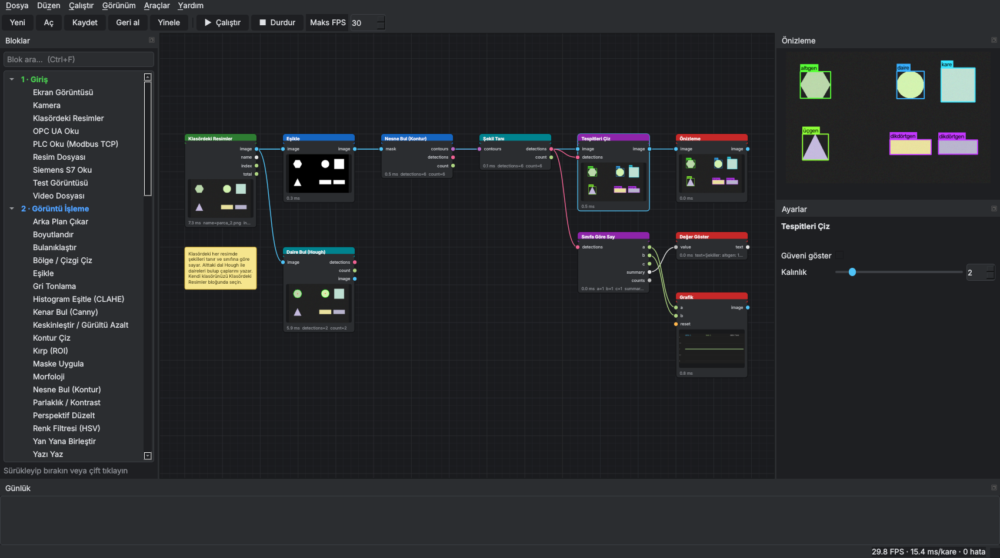
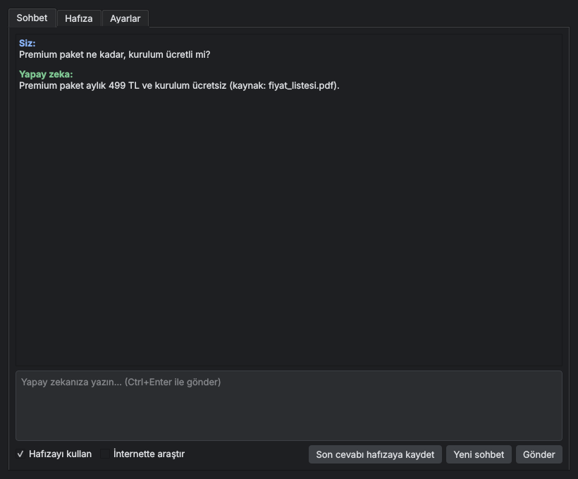

# AutoMove Studio

Kod yazmadan, blokları sürükleyip birbirine bağlayarak **görüntü işleme, yapay zeka ile nesne tespiti ve otomasyon** akışları kurduğunuz masaüstü programı. AugeLab Studio benzeri, ama açık mimarili ve genişletilebilir.



## Hızlı başlangıç

**Windows:** Hazır kurulum için `VisionFlow-Kurulum-Setup.exe` dosyasını çalıştırın (tek tıkla masaüstü kısayolu, başlat menüsü ve tüm kütüphaneler kurulur).

Geliştirici modunda çalıştırmak isterseniz:

```
pip install -r requirements.txt
python -m visionflow                      # editörü açar
python -m visionflow examples/kenar_algilama.json
```

Sonra **Dosya → Örnekler** menüsünden bir örnek açıp **F5** (Çalıştır) tuşuna basın. Kamera yoksa "Test Görüntüsü" bloğu ile denenebilir.

## Kullanım

| İşlem | Nasıl |
|---|---|
| Blok ekle | Soldaki listeden sürükleyip bırakın veya çift tıklayın. `Ctrl+F` ile arayın |
| Bağla | Bir çıkış noktasından girişe sürükleyin. Renkler veri tipini gösterir, uyumsuz tipler bağlanmaz |
| Bağlantıyı taşı | Bağlı bir girişi tutup başka yere sürükleyin |
| Sil / Çoğalt | `Del` / `Ctrl+D` |
| Kopyala / Yapıştır | `Ctrl+C` / `Ctrl+V` (akışlar arasında da çalışır) |
| Geri al / Yinele | `Ctrl+Z` / `Ctrl+Y` |
| Sağ tık menüsü | Tuvalde sağ tıklayın: blok ekle, kopyala, sil |
| Hızlı ekle | Tuvalde `Tab` (veya `Ctrl+Space`), birkaç harf yazın, `Enter` |
| Devre dışı bırak | `Ctrl+E`: blok atlanır, girişi doğrudan çıkışa geçer (deneme yaparken) |
| Not | "Not" bloğu ile tuvale açıklama yazın |
| Yorum çerçevesi | Blokları seçip `Ctrl+G` (veya sağ tık → Seçilenleri yorum çerçevesine al): akışın bir bölümünü renkli, başlıklı bir çerçeveyle gruplayın. Başlığından sürükleyince içindeki bloklar da taşınır, sağ alt köşesinden boyutlanır, başlığa çift tıklayıp açıklama yazılır (ilk satır başlık, diğerleri çerçevenin içinde) |
| Alt akış (grup blok) | Blokları seçip `Ctrl+Alt+G` (veya sağ tık → Seçilenleri alt akış yap): seçilenler tek bir bloğa dönüşür, dışarıyla bağlantıları o bloğun girişleri ve çıkışları olur. Çift tıklayınca içi açılır ve düzenlenir; üstteki *⬆ Üst akışa dön* (veya `Alt+↑`) ile çıkılır. Çalışırken içerideki blokların önizlemeleri de görünür. Sağ tık → *Alt akış kütüphanesine kaydet* ile başka akışlarda *Blok ekle → Alt akış kütüphanesi*'nden tekrar kullanılır; *Alt akışı çöz* blokları geri koyar. Alt akış içinde alt akış olabilir |
| Tuvalde gezin | Tekerlek: yakınlaş, sağ veya orta tuş: kaydır, `F`: hepsini sığdır |
| Canlı ayar | Çalışırken bir blok seçip sağdaki kaydırıcılarla oynayın, sonuç anında görünür |
| Düzenle | `Ctrl+Shift+L`: blokları otomatik hizalar |
| Özel Blok Stüdyosu | `Ctrl+Shift+B` veya sol paneldeki `🎨 + Özel Blok Oluştur…`: Görsel olarak port ve parametreleri belirleyin, Python/OpenCV kodunuzu yazın, anında test edin ve tek tıkla palete ekleyin |
| Yardım | `F1`: tüm kısayollar |
| Önizleme Araçları | Önizleme panelindeki ✛ Nişangah (optik merkezleme), ▦ Izgara (hassas hizalama) ve 📷 Kaydet (anında masaüstüne PNG kaydetme) araçları |
| Renk ölç | Önizleme panelinde fareyi görüntü üstünde gezdirin: piksel BGR ve HSV değeri yazar (renk filtresi ayarlamak için) |
| Bölge çiz | Kırp, Renk Tanı, Çizgi Geçiş Sayacı, Bölgedeki Nesneler veya Perspektif Düzelt bloğunu seçin, akış çalışırken önizlemede fareyle çizin: dikdörtgen ve çizgi için sürükleyin, bölge için köşelere tıklayıp sağ tıklayın (Perspektif: 4 köşe). Ayar kendiliğinden dolar, Ctrl+Z ile geri alınır |

## Kurulum ve Dağıtım (.exe)

VisionFlow, tek parça profesyonel Windows yükleyicisi `VisionFlow-Kurulum-Setup.exe` olarak derlenir. Python veya herhangi bir ek paket gerektirmeden her Windows 10/11 bilgisayarda çalışır.

## Arayüz olmadan çalıştırma (fabrika bilgisayarı / servis)

Editörde hazırladığınız akışı kaydedip başka bir bilgisayarda ekransız çalıştırabilirsiniz:

```
python -m visionflow.headless akis.json
python -m visionflow.headless akis.json --frames 1000 --stats 10 --fps 15
```

Paketlenmiş programda aynı şey: `VisionFlow --headless akis.json`.

## Kurulum testi

Yeni bir bilgisayara kurduktan sonra `VisionFlow --selftest` (veya `python -m visionflow --selftest`) çalıştırın. Blokları, örnek akışları, OpenCV'yi, isteğe bağlı paketleri (Claude, Excel, ses, video, YOLO), ffmpeg'i ve pencereyi kontrol eder; sonucu ekrana ve ayar klasöründeki `kurulum_testi.txt` dosyasına yazar. Sorun yoksa çıkış kodu 0'dır.

## Bloklar (228)

- **Giriş:** Kamera (USB + RTSP/IP kamera), **Endüstriyel Kamera** (GigE Vision / USB3 Vision: Basler, Hikrobot, Daheng, FLIR…), Video, Resim, **Klasördeki Resimler** (toplu kontrol), Ekran Görüntüsü, **Ekran / Pencere Yakalama (Canlı Masaüstü/SCADA)**, Test Görüntüsü, PLC Oku (Modbus TCP), **PLC Oku (Modbus RTU)**, Siemens S7 Oku, **Allen-Bradley Oku**, OPC UA Oku, **OPC UA Sunucusu: Oku**, **Modbus Sunucusu: Oku**, **EtherCAT Oku**, **EtherCAT Ağını Tara**, **Profinet Cihazlarını Bul**, **API Tetik**, **Derinlik Kamerası** (RealSense, Orbbec, dosya), **Derinlik Test Sahnesi**
- **Görüntü İşleme:** Gri, Bulanıklaştır, Canny, Eşik (Otsu, adaptif), HSV Renk Filtresi, Morfoloji, Boyutlandır, Kırp, Döndür, Maske Uygula, Parlaklık/Kontrast/Gama, CLAHE, Yan Yana Birleştir, Yazı Yaz, Bölge/Çizgi Çiz, Kontur ile Nesne Bul ve Say, Kontur Çiz, Şablon Eşleştir, **Perspektif Düzelt**, **Keskinleştir / Gürültü Azalt**, **Arka Plan Çıkar**, **Mozaik / Gizleme (KVKK)**, **Filigran / Logo Ekle**, **Otomatik Beyaz Dengesi**, **Görüntü İyileştir / Sis ve Parlama Gider**, **Termal ve Sahte Renk Paleti (Turbo/Jet/Inferno/Hot/Bone)**, **Parlama ve Yansıma Bastırıcı**, **Otomatik 4 Köşe Perspektif Düzeltici**, **Lazer / Nokta Vurma Kazıma Vurgulayıcı**, **Yüzey Çizik ve Çatlak Vurgulayıcı**
- **Kalite Kontrol ve Ölçüm:** QR/Barkod Oku, **Yazı Oku (OCR)**, ArUco İşaretçi, Hareket Algıla, Referansla Karşılaştır, Netlik Ölç, Renk Tanı, Nesne Ölç (mm ve açı), **Lens Bozulmasını Düzelt**, **Ölçek Bul (mm)** (satranç tahtası veya ArUco), **Kuşbakışı Düzelt (mm)**, **Mesafe Ölç**, **Şekil Tanı** (üçgen, kare, daire…), **Daire Bul** (çap ölçme), **Tolerans Kontrolü** (alt/üst sınır, sağlam/hatalı sayısı, verim %), **Tespiti Kırp** (bulunan nesneyi kesip OCR'a veya sınıflandırıcıya verir), **Üretim Hızı** (dakikada/saatte parça, hat durunca uyarı), **Vardiya Raporu** (vardiya sonunda sağlam/hatalı/verim özeti), **Etiket Var mı**, **Tarih Kodu Doğrula**, **Renk ile Ayıkla**, **Kenar Kusuru Bul**, **Doku / Yüzey Kusuru**, **Hizalama Kontrolü**, **Sayaç Karşılaştır**, **Baskın Renk Bul**, **Fark Isı Haritası (Kusur)**, **KPI ve Kalite Panosu (OEE / Verim)**, **Akıllı Parça Sınıflandırıcı**, **Kusur Detay Büyüteci (PIP)**, **Çapak ve Kırık Kenar Analizi**, **Delta-E Renk Toleransı (CIELAB)**, **Çoklu ROI / Matris Denetleyici (Blister/Tepsi/PCB)**, **Kumpas ve Çift Kenar Ölçer (Caliper)**, **Barkod & QR Baskı Kalite Kontrolü (ISO/IEC Notu)**, **İstatistiksel Proses Kontrolü (Cp / Cpk / SPC)**, **Eşmerkezlilik ve Çap Ölçer**, **Vida ve Cıvata Diş Adımı Kontrolü**, **Kusur Maskesi ve Isı Haritası Bindirici**
- **3B ve Derinlik:** **Derinliği Renklendir**, **Derinlik Filtresi**, **Zemin Düzlemi Bul**, **Yükseklik Ölç**, **Hacim Ölç**, **3B Nesne Bul**, **Düzlemsellik / Eğiklik**, **Derinlik Profili**, **Nokta Bulutu Kaydet**, **3B Görünüm**
- **Yapay Zeka:** YOLO v5/v8/v11 Tespit, **YOLO Segmentasyon**, **YOLO Poz Tahmini** (iskelet), **Eklem Açısı**, **YOLO Döndürülmüş Kutu (OBB)**, **Derin Anomali (PatchCore)**, Görüntü Sınıflandır (ONNX), Yüz Tespiti, Nesne Takibi, Çizgi Geçiş Sayacı, **Bölgedeki Nesneler** (çokgen alan alarmı), **Sınıfa Göre Say**, Tespit Filtrele, Tespitleri Çiz
- **Öğrenme (kendi örneklerinle, GPU gerekmez):** Örnek Topla, **Hızlı Sınıflandırıcı** (klasörden saniyede eğitilir, istenirse veri artırma), **Emin Olmadıklarını Topla** (kendi kendine öğrenme), **Anomali Tespiti** (sadece sağlam ürün resmiyle öğrenir), **Az Örnekle Segmentasyon** (birkaç resmi fırçayla boyayıp eğitilir), **Az Örnekle Nesne Bul** (birkaç resimde kutu çizip eğitilir, dönmüş parçayı da bulur), YOLO Veri Seti Kaydet (otomatik etiketleme)
- **Mantık:** Sayı, Karşılaştır, Matematik, Mantık Kapısı, Sayaç, Debounce, Zamanlayıcı, Sinyali Uzat, Mandal (SR), Seçici, Metin Oluştur, İstatistik, **Python Kodu**, Not, **Metin Koşulu** (içeriyor / regex, Türkçe harf duyarlı), **Saat Aralığında** (mesai, gece vardiyası), **Gecikme**, **Günlük Sayaç** (vardiya/gün sonunda sıfırlanır, kapanınca unutmaz), **Değişken Yaz / Değişken Oku** (kablo çekmeden değer paylaşma, istenirse kapanınca unutmaz), **Değeri Yumuşat** (titreyen ölçüm için ortalama/medyan), **Akıllı Metin Şablonu**, **Aykırı Değer Filtresi**, **PLC / Sistem Canlılık Bekçisi**, **Endüstriyel Veri ve Terazi Çözücü**
- **Alt Akışlar:** **Alt Akış** (birçok bloğu tek blokta toplar), **Alt Akış Girişi**, **Alt Akış Çıkışı**
- **Çıkış ve Otomasyon:** Önizleme, Değer Göster, Resim Kaydet, Video Kaydet, Webhook/HTTP, CSV Kaydı, Sesli Uyarı, PLC Yaz (Modbus TCP), **PLC Yaz (Modbus RTU)**, **Siemens S7 Yaz**, **Allen-Bradley Yaz**, **OPC UA Yaz**, **OPC UA Sunucusu: Yayınla**, **Modbus Sunucusu: Yaz**, **EtherCAT Yaz**, **Profinet İstasyon Adı Ata**, MQTT Gönder, Seri Port Gönder, **Web Panel** (telefondan canlı izleme), **E-posta Gönder**, **Telegram Gönder**, **WhatsApp Gönder**, **Google E-Tablolar'a Kaydet**, **Sesli Uyarı (Bip / WAV)**, **Veritabanı Kaydı (SQLite)**, **Grafik**, **Discord / Slack / Teams Gönder**, **Dosyayı Taşı / Kopyala**, **Excel'e Kaydet** (.xlsx), **Parçayı Arşivle**, **Arşivde Ara**, **Windows Sistem Bildirimi (Toast)**, **Barkod ve QR Kod Damgala**, **Sesli Konuşma ve Anons (TTS)**, **Üretim & Kalite CSV Raporlayıcı**, **PLC Modbus Word Paketleyici**, **Özel Frekans Tonu ve Akustik Alarm**, **Vardiya OEE & Hat Verimlilik Analizi**

- **AI Merkezi (Claude):** Yapay Zekaya Sor (resim de yorumlar), Yapay Zeka ile Sınıflandır, İnternette Araştır, Hafızaya Ekle, Hafızada Ara, E-posta Oku, E-postayı Cevapla, Seslendir, Video Üret, YouTube'a Yükle, Metin, Metni Dosyaya Kaydet, **Telegram Mesaj Al** (bot), **Web Sayfası Oku** (değişince haber verir), **Klasörü İzle**, **Belge Oku** (PDF/Word), **Saatte Çalıştır** (her gün 09:00 gibi), **Bilgi Çıkar** (metinden firma, tutar, tarih gibi alanlar), **API'den Veri Al** (JSON: döviz kuru, hava durumu, stok), **Haber Akışı (RSS)**, **Dışarıdan Tetik (Webhook Al)** (form, Zapier/Make, telefon veya başka bir program akışı tetikler)

Ek paket gerektirenler: MQTT `paho-mqtt`, seri port ve Modbus RTU `pyserial`, Siemens `python-snap7`, Allen-Bradley `pycomm3`, Basler kameralar `pypylon`, diğer endüstriyel kameralar `harvesters`, OPC UA (istemci ve sunucu) `asyncua`, EtherCAT `pysoem`, Profinet (Windows) `scapy`, derinlik kameraları `pyrealsense2` / `pyorbbecsdk`, OCR `pytesseract` + Tesseract programı. Hepsi için: `pip install -r requirements-extra.txt`

### PLC bağlantıları

| PLC / cihaz | Blok | Bağlantı |
|---|---|---|
| Modbus TCP (çoğu PLC, HMI, IO modülü) | PLC Oku / Yaz (Modbus TCP) | Ethernet |
| Modbus RTU (sıcaklık kontrol cihazı, sürücü, enerji analizörü, eski PLC) | PLC Oku / Yaz (Modbus RTU) | RS-485 / RS-232, USB çevirici |
| Siemens S7-300/400/1200/1500 | Siemens S7 Oku / Yaz | Ethernet |
| Allen-Bradley ControlLogix, CompactLogix, Micro800, SLC 500, MicroLogix | Allen-Bradley Oku / Yaz | EtherNet/IP |
| OPC UA sunucusu olan her şey | OPC UA Oku / Yaz | Ethernet |
| PLC / SCADA / HMI **VisionFlow'a** bağlansın | OPC UA Sunucusu, Modbus Sunucusu | Ethernet |
| EtherCAT slave'leri (IO, sürücü) | EtherCAT Oku / Yaz | Ayrı Ethernet kartı |
| Profinet cihazları (bulma, ad/IP atama) | Profinet Cihazlarını Bul / İstasyon Adı Ata | Ethernet |

Modbus RTU: aynı RS-485 hattında birden çok cihaz varsa her cihaz için ayrı blok koyun (cihaz adresi farklı, port, hız ve parite aynı). Bloklar portu paylaşır ve sırayla konuşur. Allen-Bradley'de etiket adını PLC programındaki gibi yazın (`Sayac`, `Program:Main.Hatali`); SLC/MicroLogix'te dosya adresi (`N7:0`, `F8:1`, `B3:0/1`).

### Endüstriyel kameralar

**Endüstriyel Kamera** bloğu GigE Vision ve USB3 Vision kameralarla çalışır:

- **Basler:** `pip install pypylon` yeterli.
- **Hikrobot, Daheng, FLIR, Allied Vision ve diğer GenICam kameralar:** `pip install harvesters` ve kamera üreticisinin yazılımı (Hikrobot için MVS). Program üreticinin `.cti` dosyasını kendisi bulur; bulamazsa blok ayarlarından seçin.

Kamerayı bulmak için **Araçlar → Endüstriyel Kameraları Bul**: kamerayı seçip *Akışa ekle* deyin. Pozlama (µs) ve kazanç (dB) akış çalışırken değiştirilebilir. Tetik seçenekleri:

- **Sürekli:** kamera durmadan çeker.
- **Yazılım tetiği:** `trigger` girişi açılınca tek kare çeker (bağlı değilse her turda bir kare).
- **Donanım tetiği (Line0 / Line1):** sensör veya PLC sinyali gelince çeker. Sinyal yokken akış hata vermeden bekler, sonraki bloklar eski kareyi tekrar işlemez (sayımlar şişmez).

GigE kamerada görüntü gelmiyorsa kameranın IP adresinin bilgisayarla aynı ağda olduğundan emin olun (üreticinin IP aracı ile) ve mümkünse ağ kartında "jumbo frame" açın.

## AI Merkezi: kendi yapay zekanız ve otomasyon



**Araçlar → AI Merkezi** (`Ctrl+M`):

- **Ayarlar:** Claude API anahtarınızı girin ([console.anthropic.com](https://console.anthropic.com/settings/keys), kullandıkça ücretli). Kişilik kutusuna yapay zekanızın nasıl davranacağını yazın. E-posta blokları için hesabınızı (Gmail'de "uygulama şifresi"), YouTube için Google `client_secret.json` dosyasını, Telegram botu için token'ı ve izinli chat ID'leri girin. **Günlük harcama sınırı** (varsayılan 5 $) aşılınca Claude çağrıları o gün durur; bugünkü harcama aynı sekmede görünür. Ayarlar bu bilgisayarda saklanır.
- **Hafıza:** Belgelerinizi (PDF, Word, txt, md, eml, csv) veya bir klasörü ekleyin. Hafıza bu bilgisayarda tek bir dosyadır; soru sorulunca sadece ilgili parçalar Claude'a gönderilir. Böylece yapay zeka sizin fiyat listenizi, SSS'nizi, ürünlerinizi bilir.
- **Sohbet:** Hafızayı kullanan, önceki konuşmayı hatırlayan sohbet. "İnternette araştır" işaretlenirse güncel bilgiyi arar.

**Yapay zeka ile akış kur** (`Ctrl+K`): "Kamerada insan görünce fotoğrafını Telegram'a gönder" gibi yazın; Claude blokları seçer, bağlar ve ayarlar. Her blok, bağlantı ve ayar programda kontrol edilir, hata varsa Claude'a düzelttirilir. Sonuç `Ctrl+Z` ile geri alınabilir.

**Hazır örnekler:**
- **E-posta asistanı:** Yeni gelen her e-postaya hafızanızdaki bilgilerle cevap yazar ve **Taslaklar** klasörüne koyar; siz kontrol edip gönderirsiniz. "Hemen gönder" moduna almak sizin elinizde.
- **Telegram asistanı:** Botunuza yazılan mesajlara Claude cevap verir. Sadece izin verdiğiniz kişilere cevap verilir.
- **Fatura okuyucu:** `faturalar` klasörüne bırakılan PDF/Word faturalardan firma, tutar ve tarihi çıkarıp veritabanına yazar, dosyayı `faturalar_islendi` klasörüne taşır.
- **Haber özeti:** Seçtiğiniz kelimeleri içeren yeni haberleri Claude 3 cümleyle özetler, Telegram'a gönderir.
- **Sipariş toplayıcı:** Web formundan veya başka bir programdan gelen siparişlerden ürün, adet ve müşteriyi çıkarır, Excel'e yazar, günün sipariş sayısını tutar ve Telegram'a haber verir. Adres: `http://127.0.0.1:8765/`. Token girilmemişse sadece bu bilgisayardan gelen JSON istekleri kabul edilir (tarayıcıda açık bir sitenin akışı tetiklemesini önler). Form, adres parametresi veya ağdan erişim için token belirleyin; token `X-Token` başlığıyla veya `?token=` ile gönderilir.
- **Döviz kuru bildirimi:** Hafta içi 09:00 ve 15:00'te dolar kurunu alıp Discord/Slack/Teams kanalına yazar.
- **Araştır, seslendir, video:** Günde bir kez konuyu internette araştırır, video metni yazar, Türkçe seslendirir, alt yazılı MP4 yapar. YouTube bloğu kapalı gelir; açarsanız video "private" yüklenir.

**Akışı denetle** (`Ctrl+Shift+D`): Çalıştırmadan önce bağlanmamış blokları, eksik ayarları (Claude anahtarı, e-posta hesabı, Telegram token'ı, webhook adresi) ve sıralı işlem bağlantısı eksik akışları listeler; çift tıklayınca bloğa gider. Arayüzsüz: `python -m visionflow.headless akis.json --check`.

Sıralı işler: "E-posta Oku", "Telegram Mesaj Al" ve "Klasörü İzle" bloklarının **sonraki** girişine son adımın **done** çıkışını bağlayın; bir iş bitmeden sıradakine geçilmez (bu geri bağlantı döngü sayılmaz). Son adım hiç bitmezse 10 dakika sonra sıradakine geçilir.

Arayüzsüz de çalışır: `python -m visionflow.headless examples/eposta_asistani.json`. Akışı yazıyla kurmak için: `python -m visionflow.assistant "istek" -o akis.json`.

## 2.3'teki yenilikler

### 🖥 Ekran Tasarımcısı: kodsuz operatör ekranı
- **Araçlar → Ekran tasarımcısı…** ile kendi HMI ekranınızı sürükle-bırak ile kurarsınız: canlı görüntü, büyük sayı (renk eşikleriyle), lamba, çubuk/gösterge, trend grafiği, düğme, sayı/metin girişi, reçete seçici, alarm listesi, sayaç tablosu, yazı, resim, dikdörtgen.
- Izgaraya yapışma, çoklu seçim, hizalama, kopyala/yapıştır, sınırsız geri al, birden çok sayfa ve sayfa düğmeleri, **Önizleme (F5)**.
- Öğeler blok çıkışlarına, blok ayarlarına (alt akışların içi dahil), paylaşılan değişkenlere ve sayaçlara bağlanır. Düğmeler değişken veya ayar yazar, akışı başlatır/durdurur, sayaç sıfırlar, reçete değiştirir.
- **Panel düzeni: Tasarım ekranı** seçilince operatör paneli ve `--operator` bu ekranı tam ekran gösterir; her ekran boyutuna oranı korunarak sığar. Kilitli akışta ayar değiştiren öğeler şifre ister.

### 🧊 3B ve derinlik kameraları
- **Derinlik Kamerası**: Intel RealSense, Orbbec veya dosya (16 bit PNG, .npy, .ply). Kamera olmadan denemek için **Derinlik Test Sahnesi**.
- Yeni kategori **2c · 3B ve Derinlik**: zemin düzlemi bulma (RANSAC), yükseklik ölçme, hacim ölçme (cm³), 3B nesne bulma (yükseklik ve hacimle; sayma/çizim bloklarıyla çalışır), düzlemsellik/eğiklik, derinlik profili, renklendirme, filtre, nokta bulutu kaydetme (.ply).
- **🧊 3B Görüntüle…** penceresi nokta bulutunu döndürüp yakınlaştırarak gösterir; OpenGL gerekmez.
- Yapay sahnede doğruluk: zemin 0,5° / 1 mm, yükseklik 1 mm, hacim %3 içinde. Hazır şablon: **Derinlik kamerasıyla yükseklik ve hacim ölçümü**.

### 🗃 Veri Seti Yöneticisi ve otomatik etiketleme
- **Araçlar → Veri seti yöneticisi…**: YOLO, Roboflow, COCO ve Pascal VOC veri setlerini açar; sınıf başına sayılar, denge grafiği ve sorunları (küçük/taşan kutu, bozuk satır, kopya resim) gösterir.
- Sınıf yeniden adlandır/birleştir/sil (önce yedek alınır), sınıf dengeli eğitim/doğrulama/test bölmesi, YOLO/COCO/VOC'a dönüştürme, kutuları doğru dönüştüren veri çoğaltma.
- **Otomatik etiketle**: Az Örnekle Nesne Bul (.vfdet) ya da YOLO (.onnx) modeliyle etiketsiz resimlere öneri yazar; en emin olunmayandan başlayarak kabul (Enter) / ret (Del). Birkaç etiketli resimden model eğitip kalanları önerebilir.
- Komut satırı: `python -m visionflow veriseti istatistik|bol|donustur|etiketle …`.

### 🏭 İstasyon Yöneticisi: bir bilgisayarda birden çok hat
- **Araçlar → İstasyon yöneticisi…** birden çok akışı aynı anda, her birini **ayrı işlemde** çalıştırır; bir kamera çökse de diğerleri durmaz.
- Tabloda durum lambası, canlı önizleme, FPS, hata, yeniden başlatma, çalışma süresi ve son hata; istasyon başına başlat/durdur, reçete, işlemci önceliği, çekirdek seçimi, ayrı REST API portu.
- Çöken istasyon 1, 2, 4… sn bekleyip yeniden başlar, en fazla N kez.
- Düzenleyici olmadan: `python -m visionflow istasyonlar hat.json`; açılışta hepsi: `python -m visionflow servis kur --istasyonlar hat.json`.

### Uzaktan kontrol düzeltmeleri
- `--operator` ile açılan panel de API'yi açar; `servis kur --api PORT`; `--api` ile `--yeniden-baslat --en-fazla-yeniden` birlikte çalışır; `/durum` artık önceki akışın reçetesini göstermiyor.

## 2.2'deki yenilikler

### Yeni akış: şablon galerisi
- **Dosya → Yeni… (Ctrl+N)** şablon galerisini açar (boş akış: **Dosya → Boş akış**, Ctrl+Shift+N). Program ilk açıldığında da gelir; "Program açılınca gösterme" ile kapatılır.
- Her şablon bir kart: akışın küçük resmi, açıklama, kategori (Kalite kontrol, Sayma, Ölçüm, PLC, Yapay zeka, Otomasyon) ve Türkçe harflere duyarsız arama.
- **Kullan** birkaç soru sorar (görüntü kaynağı: örnek resim / USB kamera / IP kamera / video / klasör; PLC IP; tolerans…) ve cevapları blok ayarlarına yazar. PLC çıkışları siz "PLC'ye yaz" demedikçe kapalı gelir.
- 8 yeni hazır şablon, örnek resimleriyle: etiket var/yok, kapak ve conta, renkle ayıklama + PLC, tarih/lot kodu okuma, kit sayma ve eksik parça alarmı, boyut ölçüm + tolerans + rapor, yüzey çizik/leke, plaka hizalama.

### 7 yeni muayene bloğu
- **Etiket Var mı**: etiket var mı, kaymış mı, eğik mi (renkle veya şablon resimle).
- **Tarih Kodu Doğrula**: OCR metnindeki tarihi bulur (12.10.2026, 2026-10-12, 12OCT26, 12 Ekim 2026…), SKT geçmiş mi, bugünün/vardiyanın tarihi mi, en az N gün var mı bakar; OCR karışıklıklarını (O→0) düzeltir.
- **Renk ile Ayıkla**: parçanın rengini adlandırdığınız renklerden en yakınına atar (Lab, ΔE toleransı), PLC için renk numarası verir.
- **Kenar Kusuru Bul**: dış hatta çentik, kırık ve çapak bulur.
- **Doku / Yüzey Kusuru**: çizik, leke ve doku bozukluğu; hassasiyet ayarlı.
- **Hizalama Kontrolü**: iki işaretten veya en uzun çizgiden açı ve kayma, toleransla.
- **Sayaç Karşılaştır**: "3 vida, 2 somun" gibi beklenen adetle karşılaştırır, "1 somun eksik" yazar.

### Az örnekle nesne bulma
- **Az Örnekle Nesne Bul** bloğundaki **🔲 Kutu Çiz ve Eğit…** penceresinde 3–10 resimde parçaların etrafına kutu çizip **Eğit**'e basarsınız; model birkaç saniyede hazır olur, sonucu canlı gösterir. Kaçırılanlara kutu çizip yeniden eğitirsiniz, doğru bulunanları tek tıkla kutuya çevirirsiniz.
- Dönmüş (her açı) ve biraz büyük/küçük görünen parçaları bulur, benzer renkli ama başka şekilli parçaları eler. Birden çok sınıf olur. GPU ve internet gerekmez; 640×480 resimde tek sınıf için yaklaşık 60–150 ms.
- Çıkış YOLO bloklarıyla aynı biçimdedir (Tespitleri Çiz, Sınıfa Göre Say, Nesne Takibi… doğrudan bağlanır); ayrıca parçanın açısını verir.
- Örnek: `examples/az_ornekle_nesne_bulma.json`. Not: renkli resimle eğitilen model gri kamerada çalışmaz; gri kamera için gri resimle eğitin.

### İzlenebilirlik arşivi
- **Parçayı Arşivle** her parçayı seri no / barkod, lot, sağlam/hatalı kararı, sebep, ölçümler, reçete, orijinal ve işaretli görüntüyle saklar. Yazma arka planda yapılır, yavaş disk hattı yavaşlatmaz.
- Saklama: "kaç gün" ve/veya "en fazla GB", eskiler kendiliğinden silinir; görüntü saklama "hepsi / yalnız hatalılar / hiçbiri".
- **Arşivde Ara**: tekrar kontrol istasyonunda seri numarasının son kaydını verir.
- **Araçlar → İzlenebilirlik arşivi…** (operatör panelinde **Arşiv** düğmesi): tarih, seri no, sonuç, istasyon, reçete filtreleri, görüntüler, özet (hata oranı, en sık sebepler), CSV / Excel / görüntülü ZIP dışa aktarma.
- Komut satırı: `python -m visionflow arsiv --seri ABC123`, `python -m visionflow arsiv --disa-aktar rapor.csv --baslangic 2026-10-01`.

### Uzaktan kontrol (REST API) ve güvenli OPC UA
- MES, ERP veya kendi programınız VisionFlow'u `http://bilgisayar:port/api/v1/` üzerinden yönetir: durum, başlat/durdur, blok değerleri, bir bloğun son görüntüsü (JPEG), reçete değiştirme, değişkenler, blok listesi, tetik. OpenAPI açıklaması `/api/v1/openapi.json`.
- Yeni blok **API Tetik**: `POST /api/v1/tetik/<ad>` gelince akışı tetikler, gönderilen JSON'u çıkışa verir.
- Güvenlik: API anahtarı zorunlu (`X-API-Key`), varsayılan yalnız bu bilgisayardan erişim, isteğe bağlı HTTPS (kendinden imzalı sertifika da oluşturulur), hız sınırı.
- **Araçlar → 🌐 Uzaktan kontrol (API)…** penceresi: aç/kapat, adres, anahtar, hazır `curl` örnekleri. Arayüzsüz: `python -m visionflow --headless akis.json --api 8790`.
- **OPC UA güvenliği**: OPC UA istemci ve sunucu bloklarında Basic256Sha256 İmzala / İmzala ve Şifrele; VisionFlow'un sertifikası otomatik oluşturulur, karşı tarafa "ilk bağlantıda güven" veya "sadece güvenilen liste". Varsayılan eskisi gibi güvenliksiz.

## 2.1'deki yenilikler

### VisionFlow artık bir sunucu: PLC, SCADA ve HMI bize bağlanır
- **OPC UA Sunucusu: Yayınla** bir değeri (sayı, doğru/yanlış, metin) VisionFlow'un OPC UA sunucusunda bir değişkene yazar; PLC veya SCADA `opc.tcp://<bilgisayarın IP'si>:4840/visionflow/` adresine bağlanıp okur. Değişkenler `Objects/VisionFlow/<klasör>` altında, düğüm kimliği `ns=2;s=VisionFlow.<klasör>.<ad>`.
- **OPC UA Sunucusu: Oku** PLC'nin yazabileceği bir değişken açar (başlangıç değeriyle) ve değeri ile "değişti" sinyalini verir; PLC'den komut, reçete numarası, tetik almak için.
- Kullanıcı adı / şifre isteğe bağlı (boşsa anonim). Aynı portu kullanan bütün bloklar tek sunucuyu paylaşır; akış durunca sunucu kapanır, port boşalır.
- **Modbus Sunucusu: Yaz / Oku**: VisionFlow'u Modbus TCP slave yapar (ek paket gerekmez). Holding register, bobin, giriş register'ı; 16-bit tamsayı, 32-bit tamsayı ve 32-bit ondalık (kelime sırası seçilebilir). Varsayılan port 5020 (502 Linux'ta yönetici ister).
- Örnek: `examples/opcua_sunucu.json` nesne sayısını hem OPC UA hem Modbus üzerinden yayınlar.

### EtherCAT ve Profinet
- **EtherCAT Oku / Yaz**: `pysoem` ile EtherCAT master. Slave no, bayt adresi, veri tipi (bit, 8/16/32-bit, float). Aynı ağ kartındaki bloklar tek master'ı paylaşır; süreç verisi arka planda ayarlanabilir çevrimle (varsayılan 4 ms) akar, slave'ler otomatik OP'ye alınır, kopukluktan sonra kurtarılır, akış durunca çıkışlar sıfırlanır.
- **EtherCAT Ağını Tara**: ağ kartlarını ve slave'leri (ad, üretici, ürün kodu, IO boyutu, durum) listeler.
- **Profinet Cihazlarını Bul**: ağdaki Profinet cihazlarını DCP ile bulur (TIA Portal'daki "Erişilebilir cihazlar" gibi): istasyon adı, IP, MAC, üretici/cihaz kimliği.
- **Profinet İstasyon Adı Ata**: MAC adresiyle cihaza istasyon adı / IP atar; yalnız "Onaylıyorum" işaretliyken ve tetik gelince bir kez gönderir.
- Profinet PLC ile **veri alışverişi** için Siemens S7 blokları, PLC'nin OPC UA sunucusu veya VisionFlow'un yeni OPC UA / Modbus sunucusu kullanılır; gerçek Profinet IO gerekiyorsa PN/PN coupler veya ağ geçidi. (Çevrimsel Profinet IO saf Python ile yapılamaz.)
- Gerekenler: EtherCAT için `pip install pysoem`; Windows'ta Npcap, Linux'ta root veya `cap_net_raw` yetkisi. Profinet bulma Linux'ta ek paket istemez, Windows'ta Npcap + `scapy` ister.

### GPU hızlandırma (CUDA, TensorRT, OpenVINO, DirectML, CoreML)
- Bütün yapay zeka blokları (YOLO tespit / segmentasyon / poz / OBB, Görüntü Sınıflandır, PatchCore) modeli tek yerden seçilen cihazda çalıştırır.
- **Araçlar → ⚡ Hızlandırma (GPU)…** bulunan cihazları ve eksikse ne kurulacağını gösterir, "bu bilgisayar" ve "bu akış" için varsayılan cihazı seçtirir, FP16 açılır, **Hız testi** her cihazda ms/kare ölçer.
- Her ONNX bloğunda **Cihaz** ayarı ("Genel ayar" varsayılan) ve gerçekte kullanılan cihazı veren **device** çıkışı var.
- GPU açılamazsa akış durmaz: CPU ile devam eder, `CPU (yedek)` yazar ve uyarı verir.
- Komut satırı: `python -m visionflow gpu-test`. Kurulum testi GPU durumunu da gösterir.

### Az örnekle segmentasyon: boya, eğit, kullan
- **Az Örnekle Segmentasyon** bloğundaki **🖌 Etiketle ve Eğit…** düğmesi bir pencere açar: 3–10 resmi fırça ve silgiyle boyarsınız (sınıf ekle / yeniden adlandır, renk, geri al), **Eğit**'e basınca model saniyeler içinde eğitilir ve sonucu resmin üstünde canlı gösterir. Yanlış yerleri boyayıp tekrar eğitirsiniz. GPU ve internet gerekmez.
- Dikdörtgen çizerek **GrabCut ile hızlı maske** çıkarılabilir.
- Blok maske (sınıf numarası veya seçilen sınıf), renkli bindirme, sınıf başına alan % ve hedef sınıftaki nesne sayısını verir; küçük bölgeleri siler, kenarları yumuşatır. Model tek bir `.vfseg` dosyasıdır.
- Örnek: `examples/az_ornekle_segmentasyon.json`.

## 2.0'daki yenilikler

### Hat ekranı: Operatör Paneli, kilit ve üretim raporu
- **Operatör Paneli (HMI):** Çalıştır → *Operatör Paneli…* (F9) akışı hat ekranı olarak çalıştırır: büyük canlı
  görüntü (varsayılan: akıştaki Önizleme bloğu), büyük yeşil **SAĞLAM** / kırmızı **HATALI** lambası, büyük sayaçlar
  (sağlam, hatalı, toplam, verim %), zaman damgalı son N sonuç listesi, *Başlat / Durdur* ve *Sayaçları sıfırla*
  düğmeleri. F11 tam ekran.
- Doğrudan panelle açmak için: `python -m visionflow --operator akis.json` (tam ekran açılır ve akışı hemen başlatır).
- **Operatör paneli ayarları** (Çalıştır menüsü): hangi bloğun görüntüsünün gösterileceği, lambayı hangi
  doğru/yanlış çıkışın süreceği, sağlam/hatalı/toplam sayaçlarının hangi sayı çıkışlarından alınacağı (ör. Tolerans
  Kontrolü ok_count / nok_count; seçilmezse lambanın her yeni sonucu bir parça sayılır), başlık ve son sonuç sayısı.
  Ayarlar akış dosyasına kaydedilir (eski sürümler bu bilgiyi yok sayar).
- **Düzenleme kilidi:** aynı pencerede isteğe bağlı şifre. Kilitli akış düzenleyicide şifresiz açılamaz; operatör
  panelinden düzenleyiciye geçmek veya paneli kapatmak şifre ister. Şifrenin kendisi saklanmaz, akış dosyasına tuzlu
  PBKDF2-SHA256 özeti yazılır (kilit akışla birlikte hat bilgisayarına taşınır). Not: bu bir güvenlik duvarı değil,
  hattaki yanlışlıkla/izinsiz değişikliğe karşı bir korumadır; dosyayı metin düzenleyiciyle değiştirebilen kişi kilidi
  kaldırabilir.
- **Üretim verisi:** operatör paneli çalışırken sağlam/hatalı/toplam sayıları ve alarmlar (blok hataları) dakikada
  bir akışın klasöründeki `uretim_verisi.sqlite` dosyasına yazılır (kaydedilmemiş akışta kullanıcı klasörüne).
- **Üretim raporu:** Araçlar → *Üretim raporu…* seçilen tarih aralığı için tek dosyalık HTML rapor yazar: akış adı,
  dönem, toplamlar, verim, saatlik tablo, saatlik sağlam/hatalı çubuk grafiği (gömülü SVG) ve son alarmlar.
  İsteğe bağlı aynı rapor PDF olarak da kaydedilir.
- **Yeni blok — Rapor Oluştur** (5 · Çıkış ve Otomasyon): `trigger` yanlış→doğru olunca son N saatin raporunu
  (HTML, isterseniz PDF) rapor klasörüne yazar; dosya yolunu `path` çıkışından verir (E-posta/Telegram bloklarına
  bağlanabilir). PDF yalnızca arayüz açıkken oluşturulur; arayüzsüz çalıştırmada HTML yazılır ve bilgi verilir.

### Reçeteler (ürün tipleri) ve alt akışta dışarı açılan ayarlar
- **Alt akışta dışarı açılan ayarlar:** Alt akışın içindeki bir bloğun ayarını alt akış bloğunun kendi
  ayarlarında gösterebilirsiniz. Alt akışın içinde ayarlar panelinde ayarın adına sağ tıklayıp
  **"Bu ayarı alt akış bloğunda göster"** deyin (veya tuvalde bloğa sağ tık → *Ayarı alt akış bloğunda göster*).
  Ayar, alt akış bloğunda **"<blok adı>: <ayar adı>"** olarak, normal bir ayar gibi düzenlenir; akış çalışırken
  değiştirmek anında içerideki bloğa geçer. Kaydetme/açma, kopyala-yapıştır, alt akış kütüphanesi ve geri al ile
  birlikte korunur; yapıştırılan her kopya kendi değerini tutar. İçerideki blok veya ayar silinirse kendiliğinden
  kalkar. İç içe alt akışlarda, içteki alt akışın açtığı ayar dıştakinde de gösterilebilir.
- **Reçeteler (ürün tipleri):** Araçlar → **Reçeteler…** penceresinde ürün tipleri oluşturun (ör. *A ürünü*: eşik 120,
  tolerans 10-12 mm). Tuvalde blokları seçip **"Seçili blokların değerlerini al"** ile o anki ayarları reçeteye
  alın; değerleri tabloda düzenleyin, satır kaldırın, reçeteyi yeniden adlandırın, silin veya **uygulayın**.
  Reçeteler akış dosyasının içinde saklanır (eski sürümler bu bilgiyi görmezden gelir). Alt akışın içindeki bir ayar
  için o ayarı önce alt akış bloğunda gösterin.
- **Yeni blok: Reçete Seç** (4 · Mantık): Ayarındaki reçeteyi akış başlarken uygular; girişine reçetenin adı (yazı)
  veya numarası (sayı, ör. PLC'den; 1'den veya 0'dan başlar) bağlanırsa değer değiştiğinde akış çalışırken o reçeteye
  geçer. Değerler karenin ortasında değil, bir sonraki kareden önce uygulanır; ayarı `setup` sırasında okunan bloklar
  (model, kamera, dosya) yeniden başlatılır. Editörde de yeni değerler görünür. Çıkışları: reçete adı, numarası,
  değişti mi.
- **Arayüzsüz çalıştırma:** `python -m visionflow.headless akis.json --recete "A ürünü"` (veya `--recete 2`) akışı
  o reçeteyle başlatır; akıştaki "Reçete Seç" blokları da bu reçeteyle başlar.

### Yeni ölçüm ve kontrol blokları
**Kalite Kontrol ve Ölçüm** kategorisine 9 yeni blok (`visionflow/nodes/vision_more.py`). Hepsi gri, renkli,
4 kanallı (BGRA), 16-bit ve ondalıklı (float) görüntüyle çalışır; bölgeler önizlemede fareyle çizilebilir.

- **Özellik Eşleştir (Nesne Bul)**: referans resimdeki desenli nesneyi (etiket, logo, parça) döndürülmüş,
  büyütülmüş/küçültülmüş olsa da bulur (ORB veya SIFT + oran testi + RANSAC homografi). Kutu, merkez, açı, ölçek,
  skor verir; birden çok nesne bulabilir. Referans dosyadan veya `reference` girişinden.
- **Çizgi Bul (Hough)**: düz çizgileri bulur; en uzun çizginin açısı (°) ve uzunluğu, açı aralığı süzgeci, bölge.
- **Kenar Ölç (Kumpas)**: çizilen ölçüm çizgisi boyunca kenarları piksel altı hassasiyetle bulur, iki kenar
  arasındaki mesafeyi px veya mm verir. Kenar yönü (koyudan açığa / açıktan koyuya), "ilk iki" / "en dış" kenar.
- **Leke / Kusur Bul (Blob)**: düz yüzeyde koyu/açık leke, delik, çizik; ışık eşit değilse de çalışır (yerel
  medyan arka plan). Alan ve yuvarlaklık süzgeci; sayı, toplam ve en büyük leke alanı.
- **Doluluk Seviyesi**: şişe/kap içindeki sıvı çizgisini bulur; seviye % ve px, min-max'a göre ok.
- **Renk Alanı %**: bölgedeki piksellerin yüzde kaçı HSV aralığında (kaplama, pas, yanık kontrolü).
- **Histogram Karşılaştır**: renk/parlaklık dağılımını referansla karşılaştırır, 0..1 benzerlik (korelasyon,
  Bhattacharyya, kesişim).
- **Otomatik Hizala**: görüntüyü referansa hizalar (ECC veya ORB özellik); kayan/dönen parçada sonraki sabit
  bölgeler doğru yere düşer. dx, dy, açı ve uyum skoru verir.
- **Sayma Izgarası (Tepsi Kontrol)**: bölgeyi satır × sütun hücreye böler, her hücre dolu mu boş mu (parlaklık
  veya renk) bakar; boş hücre numaralarını metin olarak verir. Tepsi, blister, yumurta kolisi, kasa kontrolü.
- Yeni örnek: `examples/tepsi_kontrol.json` (örnek resim `examples/ornek_veri/tepsi.png`, 3. ve 8. hücre boş).

### Üretim hattı blokları
- **Üretim hattı blokları** (yeni `visionflow/nodes/production.py`):
  - **Ret Kapısı Gecikmesi (Kaydırma Yazmacı)**: kamera hatalı parçayı görür, üfleyici/itici bantta daha ileridedir. Hatalı parçalar sıraya (FIFO) girer; parça üfleyiciye varınca `reject` ayarlanan süre (ms) kadar doğru olur. Mesafe: parça sayısı, enkoder darbesi (taşma değeri desteklenir) veya süre (ms). Sık gelen parçalar ayrı ayrı izlenir; bekleyen ret sayısı ve toplam ret çıkışı vardır.
  - **SPC (İstatistiksel Süreç Kontrol)**: alt gruplu X-bar kartı (n = 1 ise bireysel/hareketli aralık): ortalama, sigma, Cp, Cpk, UCL/LCL. Western Electric kuralları: 1) 3σ dışında nokta, 2) 9 nokta aynı tarafta, 3) 6 nokta sürekli artış/azalış (isteğe bağlı 4 ve 5). Alarm metni hangi kuralın bozulduğunu yazar. İlk N nokta sınırları öğrenir (0 = kayan pencere).
  - **OEE Hesapla**: Kullanılabilirlik × Performans × Kalite (%), duruş ve çalışma dakikası; parça girişleri sayaç değeri veya darbe olabilir; vardiya saatlerinde otomatik sıfırlanır.
  - **Parti / Lot Takibi**: barkoddan gelen ya da otomatik (ÖNEK-YYYYAAGG-001) lot numarası, lot başına parça, lot dolunca `done` darbesi; durum kaydedilir, program yeniden açılınca kaldığı yerden devam eder.
  - **Duruş Sebebi Kaydı / Alarm Geçmişi**: her alarm/duruşun başlangıç-bitiş-süre-sebebini CSV'ye (Excel'de açılır, `;` ayraçlı) yazar, son N kaydı tutar; titreşim filtresi (en kısa süre), bugünkü alarm sayısı. Dosya Excel'de açıksa satırlar kaybolmaz, sonra yazılır.
  - **Çoklu Kamera Kararı (Hepsi Sağlam mı)**: 4 istasyona kadar kararları geliş sırasıyla aynı parçada birleştirir; hangi istasyonun hatalı bulduğunu yazar; bildirmeyen istasyonda zaman aşımı alarmı verir (parça hatalı sayılır).
  - **Sinyal Üreteci / Simülatör**: donanımsız deneme için sanal konveyör: dakikada N parça tetiği, tohumlu rastgele hatalı oranı, enkoder, parça başına ölçüm (kayma ayarlı), düzenli duruşlar.
- Yeni örnek: `examples/ret_kapisi_simulasyon.json` — Simülatör → Ret Kapısı Gecikmesi, OEE, SPC → Değer Göster.

### Servis, kurulum sihirbazı, kayıt ve akış testi
- **Bilgisayar açılınca çalışan akış (servis)**: `python -m visionflow servis kur --akis akis.json [--ad AD]`
  (paketli sürümde `VisionFlow.exe servis kur ...`). Diğer işlemler: `kaldir`, `baslat`, `durdur`, `durum`.
  - **Windows**: pywin32 kuruluysa gerçek bir Windows servisi kurulur (otomatik başlar, "Durdur" ile temiz kapanır).
    pywin32 yoksa (ve paketli .exe'de) Görev Zamanlayıcı kullanılır: oturum açılınca, `--sistem` ile bilgisayar
    açılınca (SYSTEM hesabıyla, yönetici gerekir) başlar.
  - **Linux**: systemd birimi yazılır (`~/.config/systemd/user/visionflow-AD.service`, `--sistem` ile
    `/etc/systemd/system/`), `Restart=always`; `systemctl` komutları çalıştırılır. `--yazdir` hiçbir şey kurmaz,
    dosyayı ve komutları yazdırır.
- **Çökerse yeniden başlat**: `python -m visionflow --headless akis.json --yeniden-baslat` akış çökünce 1, 2, 4 … 60 sn
  bekleyip yeniden başlatır; olaylar `<VisionFlow klasörü>/kayitlar/headless.log` dosyasına yazılır (1 MB'da döner,
  5 eski dosya). `--en-fazla-yeniden N` ile sınırlanabilir. Servisler bu seçenekle kurulur.
- **Windows kurulum sihirbazı**: `installer\build_windows.bat` önce PyInstaller paketini, sonra Inno Setup 6 ile
  `dist\installer\VisionFlow-Kurulum-<sürüm>.exe` dosyasını oluşturur. Kurulum Türkçe/İngilizce; masaüstü kısayolu,
  `.json` dosyaları için "VisionFlow akışı" ile aç, isteğe bağlı "Windows ile başlat" (seçilen akış servis komutuyla
  kurulur), kaldırırken servis de kaldırılır.
- **Kare Kaydedici** (5 · Çıkış ve Otomasyon): gelen kareleri PNG olarak, zamanları ve a–d girişlerindeki değerlerle
  bir klasöre (`manifest.json`) kaydeder. "Tetikte" modunda yalnızca tetik/hata doğruyken, öncesindeki N kare ve
  sonrasındaki M kare ile birlikte kaydeder. Disk koruması: boş alan sınırın altına inince veya en fazla dosya
  sayısına ulaşınca kayıt durur. 16-bit, 4 kanallı ve gri görüntüler aynen saklanır.
- **Kayıttan Oynat** (1 · Giriş): böyle bir kaydı kamera gibi oynatır (orijinal zamanlamayla / hız çarpanıyla ya da
  olabildiğince hızlı, isteğe bağlı başa sarar); görüntüyü ve kaydedilen a–d değerlerini verir. Hattaki sorun masada
  aynen tekrar edilir.
- **Akış Testi**: `python -m visionflow test-akis akis.json --kayit KAYIT_KLASORU --beklenen beklenen.json`
  kaydı akıştan olabildiğince hızlı geçirir, seçilen çıkışları beklenen değerlerle kare kare karşılaştırır, tablo
  (GEÇTİ/KALDI) yazar; çıkış kodu 0 = geçti, 1 = kaldı, 2 = kullanım hatası. `--kaydet-beklenen` beklenen dosyasını
  oluşturur. `--cikislar "Blok başlığı.port,..."` (varsayılan: tüm sayı ve evet/hayır çıkışları), `--tolerans`,
  `--kare`. Akıştaki tek görüntü kaynağı (kamera, video, resim) otomatik olarak kayıtla değiştirilir; akışta
  "Kayıttan Oynat" varsa o kullanılır. Testte "Kare Kaydedici" blokları kapatılır.

### Editör
- **Hizala / dağıt:** Birden çok blok seçip Düzen → Hizala (veya sağ tık → Hizala) ile sola, sağa, üste, alta hizalayın, ortalayın ya da yatay / dikey eşit aralıkla dağıtın. Her işlem tek adımda geri alınır (Ctrl+Z).
- **Izgaraya yapıştır:** Görünüm → "Izgaraya yapıştır (20 px)" açıkken sürüklenen bloklar 20 piksellik ızgaraya oturur. Seçim hatırlanır.
- **Mini harita:** Tuvalin sağ alt köşesinde tüm akışın küçük bir görünümü; tıklayarak veya sürükleyerek görünümü taşıyın. Görünüm → Mini harita ile açılıp kapanır, hatırlanır.
- **Akışı resim olarak kaydet:** Dosya → "Akışı resim olarak kaydet…" tüm akışı yüksek çözünürlüklü PNG ya da SVG (çizim) olarak kaydeder — rapor ve sunumlar için.
- **Kabloyu boşluğa bırak:** Bir bağlantıyı boş tuvale bırakınca yalnızca o uca uyan bloklar listelenir; seçtiğiniz blok eklenir ve otomatik bağlanır.
- **Bloğu kablonun üzerine bırak:** Bağlantısı olmayan bir bloğu var olan bir bağlantının üzerine sürükleyin; kablo sarı yanar ve bırakınca blok araya eklenir (uçları uygunsa).
- **Akışta ara (Ctrl+P):** Akıştaki bloklar (ad, tür, hata durumu) listelenir; birkaç harf yazın (bulanık arama: "thd" → Threshold), Enter ile bloğa gidilir. Alt akış içindeyken o seviyeyi arar.
- **Hatalı bloğa git (F8):** Araç çubuğundaki ⛔ düğmesi veya F8, hata gösteren bloklar arasında sırayla gezer.
- **Açık tema:** Görünüm → Tema → Koyu / Açık. Tuval renkleri de değişir; seçim hatırlanır.
- **Blok rengi:** Sağ tık → Blok rengi ile bloklara renk etiketi verin (Kırmızı, Turuncu, Sarı, Yeşil, Mavi, Mor, Pembe, Gri). Renk akış dosyasına kaydedilir, kopyala-yapıştırda korunur, geri alınabilir.

## Kendi modelinizi eğitin

1. **Hızlı yol (saniyeler, GPU yok):** `veri/saglam`, `veri/hatali` gibi klasörlere örnek resim koyun (veya "Örnek Topla" bloğuyla toplayın), "Hızlı Sınıflandırıcı" bloğunda klasörü seçin. Klasöre resim eklendikçe kendini yeniden eğitir. Az örneğiniz varsa "Veri artırma"yı açın (her resmin aynalı, açık/koyu ve hafif döndürülmüş hâlleriyle de öğrenir; sadece yönüyle ayrılan sınıflarda, ör. sol/sağ parça, açmayın).
   **Kendi kendine öğrenme:** "Emin Olmadıklarını Topla" bloğunu sınıflandırıcının arkasına bağlayın; program emin olmadığı görüntüleri `veri/_incelenecek` klasörüne toplar. **Araçlar → Örnekleri Öğret** (Ctrl+Shift+O) ile her birini tek tuşla (1–9) doğru sınıfa koyun; sınıflandırıcı kendiliğinden yeniden eğitilir ve zamanla daha az yanılır. Hazır örnek: `examples/kendi_kendine_ogrenen.json`.
2. **Hatalı örnek yoksa:** "Anomali Tespiti" bloğuna sadece sağlam ürün resimleri verin; farklı olan her şeyi işaretler.
3. **YOLO ile (en güçlü):** **Araçlar → Etiketleme Aracı** ile kutuları çizin (veya "YOLO Veri Seti Kaydet" ile mevcut modelden otomatik etiketleyin), sonra **Araçlar → YOLO Modeli Eğit**. Bitince model `models/` klasörüne ONNX olarak kaydedilir. `pip install ultralytics` gerekir; GPU varsa çok daha hızlıdır.
   **Otomatik etiketleme:** Etiketleme aracında **Model seç** ile bir YOLO ONNX modeli (ör. ilk birkaç yüz resimle eğittiğiniz model) seçin. **M** tuşu o resimdeki nesneleri kutular, **Etiketsizleri modelle etiketle** henüz etiketi olmayan tüm resimleri kutular (etiketli resimlere dokunmaz). Siz sadece yanlışları silip eksikleri çizersiniz. **C** önceki resmin kutularını kopyalar (video kareleri için), **Ctrl+Z** son kutuyu geri alır. Böylece model her eğitimde bir sonraki etiketlemeyi hızlandırır.

### YOLO modeli

`models/` klasörüne bir ONNX modeli koyun ve YOLO bloğunda seçin:

```
pip install ultralytics
yolo export model=yolov8n.pt format=onnx
```

Aynı yolla poz (`yolo11n-pose.pt`) ve döndürülmüş kutu (`yolo11n-obb.pt`) modelleri de ONNX'e çevrilip **YOLO Poz Tahmini** ve **YOLO Döndürülmüş Kutu (OBB)** bloklarında kullanılır.

### Milimetre ile ölçüm

1. **Lens düzeltme (isteğe bağlı, geniş açılı lenslerde önerilir):** *Araçlar → Kamera Kalibrasyonu*'nda satranç tahtasını kaydedip yazdırın, kamerayla 10–20 fotoğrafını çekin (farklı açılar, resmin kenarları dahil), klasörü seçip *Kalibre et*'e basın. Akışın başına **Lens Bozulmasını Düzelt** bloğunu koyun.
2. **Ölçek:** Ölçüm düzlemine satranç tahtası (veya bilinen boyutta bir ArUco işaretçi) koyun. **Ölçek Bul (mm)** bloğu "mm başına piksel" değerini bulur; çıkışını **Nesne Ölç** veya **Mesafe Ölç** bloğunun `px_per_mm` girişine bağlayın. *Bulunca kilitle* açıkken tahtayı sonra kaldırabilirsiniz (kamera ve masa sabit kalmalı).
3. **Kamera eğik bakıyorsa:** **Kuşbakışı Düzelt (mm)** görüntüyü tam üstten bakılmış hale getirir; çıkışta her yerde 1 mm aynı sayıda pikseldir (ör. 4 piksel/mm).
4. Sonucu **Tolerans Kontrolü**'ne bağlayıp uygun / uygun değil kararı verin.

Not: Ölçüm, tahtanın durduğu düzlemde doğrudur; yüksek parçaların üst yüzeyi kameraya daha yakın olduğu için biraz büyük ölçülür.

### Derin anomali (PatchCore): sadece sağlam ürünle

Hatalı ürün toplamak zor olduğunda: `veri/saglam` klasörüne 10–50 sağlam ürün resmi koyun ve **Derin Anomali (PatchCore)** bloğunu ekleyin. Blok bu resimlerden öğrenir, alarm sınırını da kendisi belirler: **skor 1.0'ı geçen ürün hatalıdır**, ısı haritası hatanın yerini gösterir.

- **Yerleşik öznitelikler:** ek kurulum ve internet gerektirmez, hızlıdır.
- **ResNet18 (derin):** ince çizik ve doku hatalarında daha hassastır. İlk kullanımda bir kez `pip install torch torchvision` gerekir; program modeli `modeller/` klasörüne kaydeder, sonra torch olmadan da çalışır.
- Eğitim, sağlam resim klasöründe saklanır; resimler değişmedikçe program açılışta tekrar eğitmez.
- Fazla alarm veriyorsa "Sınır çarpanı"nı büyütün (ör. 1.3), hata kaçırıyorsa küçültün.

## Kendi bloğunuzu yazın (eklenti)

`plugins/` klasörüne bir `.py` dosyası koyun; açılışta otomatik yüklenir. Örnek: `plugins/ornek_eklenti.py`. Bir blok sadece `inputs`, `outputs`, `params` ve `process()` tanımlar.

## Kendini Geliştir: program kendi kodunu iyileştirir

**Araçlar → Kendini Geliştir (Ctrl+Shift+G).** Program kullanılırken blokların verdiği hataları kodun hangi satırında olduğuyla birlikte kaydeder (`hata_gunlugu.jsonl`, aynı hata bir çalıştırmada bir kez). Bu pencerede:

1. **Kendini incele:** kaydedilen hataları (en sık olan önce), yüklenemeyen eklentileri ve programın kendi testlerinin sonucunu gösterir.
2. **Geliştirme öner:** rapor ve ilgili kaynak dosyalar Claude'a gönderilir; Claude kodda en küçük düzeltmeyi (veya hedef kutusuna yazdığınız iyileştirmeyi) ve onu yakalayan bir test önerir.
3. **Kendini sorgular:** öneri önce programın geçici bir **kopyasında** denenir: değişiklik uygulanır, tüm testler ve kurulum testi çalıştırılır. Bir şey bozulursa hata Claude'a gösterilir ve öneriyi kendisi düzeltir (en çok 3 tur).
4. **Uygula:** sadece testleri geçen öneri, siz farkı (diff) görüp onaylayınca uygulanır. Eski dosyalar yedeklenir; **Geçmiş** sekmesinden tek tıkla geri alınır. Programı yeniden başlatınca etkili olur.

Güvenlik kuralları (kodla zorlanır):
- Onayınız olmadan hiçbir dosya değişmez. "Her gün kendini incele" seçeneği (varsayılan kapalı) bile sadece test edilmiş bir öneri hazırlayıp bekletir.
- Sadece `visionflow/`, `tests/` ve `plugins/` altındaki `.py` dosyaları değişebilir. Harcama sınırı ve ayarlar (`ai/config.py`), Claude bağlantısı (`ai/claude.py`) ve bu kuralların kendisi (`evolve.py`) korumalıdır. Eski bir değişiklik, aynı dosya sonradan değiştiyse geri alınmaz; önce yenisini geri alın. Program, test edildikten sonra değiştiyse öneri uygulanmadan önce yeniden test edilir.
- Paketlenmiş .exe'de program kendi kodunu değiştiremez; sadece `plugins/` klasörüne eklenti yazar (aynı adla kayıtlı bir eklenti yerleşik bloğun yerine geçer). Önerilen eklenti onaydan önce ayrı bir süreçte denenir, çalışan programa yüklenmez.
- Claude'u kendi API anahtarınızla kullanır, günlük harcama sınırınız geçerlidir.

Komut satırından sadece rapor (Claude'a sorulmaz, hiçbir şey değişmez): `python -m visionflow.evolve`.

## Mimari

```
visionflow/
  ai/         Claude bağlantısı, hafıza (SQLite), e-posta, ses/video/YouTube
  core/       akış motoru: Node, Param, Graph (topolojik sıralama, döngü ve tip kontrolü, JSON kaydetme)
  nodes/      yerleşik bloklar (inputs, processing, ai, logic, outputs)
  ui/         PySide6 node editörü (scene), paneller, arka plan çalıştırıcı (worker)
  headless.py arayüzsüz çalıştırıcı
  evolve.py   Kendini Geliştir: hata günlüğü, öneri, kopyada test, onayla uygula / geri al
examples/     hazır akışlar     plugins/  kullanıcı blokları     tests/  pytest testleri
```

Akış ayrı bir iş parçacığında çalışır, arayüz donmaz. Bir blok hata verirse sadece o dal durur, akışın geri kalanı çalışmaya devam eder ve hata bloğun üstünde kırmızı yazılır. Her bloğun işlem süresi (ms) üstünde görünür, darboğaz hemen bulunur. Bir blok başlatılamazsa (kamera yok, model eksik) sadece o blok kırmızı olur, akışın geri kalanı çalışır. Editör 30 saniyede bir kaydedilmemiş akışı yedekler; program beklenmedik kapanırsa açılışta geri yüklemeyi önerir.

## Yol haritası

0. ~~Geri al/yinele, kopyala/yapıştır, nesne takibi, çizgi sayımı, QR/barkod, Modbus, MQTT, video kaydı~~ (0.2)
0. ~~Etiketleme, model eğitimi, anomali, OCR, segmentasyon, Siemens S7, OPC UA, web panel, .exe paketleme~~ (0.3)
0. ~~E-posta, Telegram, SQLite, grafik, şekil tanıma, bölge alarmı, otomatik kayıt/kurtarma, otomatik yerleşim~~ (0.4)
0. ~~AI Merkezi: Claude, hafıza, e-posta asistanı, araştırma, seslendirme, video, YouTube, yazıyla akış kurma~~ (0.5)
0. ~~Etiketlemede yapay zeka destekli otomatik kutu önerisi, veri artırma, kendi kendine öğrenme~~ (1.3–1.4)
0. ~~Modbus RTU (RS-485), Allen-Bradley (EtherNet/IP)~~ (1.5)
0. ~~Endüstriyel kameralar: GigE Vision / USB3 Vision, Basler, Hikrobot~~ (1.6)
0. ~~Poz tahmini, döndürülmüş kutular (OBB), derin öğrenmeli anomali (PatchCore)~~ (1.7)
0. ~~Yorum çerçeveleri, kamera kalibrasyonu, mm ölçüm~~ (1.8)
0. ~~Alt akışlar (grup bloklar), alt akış kütüphanesi~~ (1.9)
0. ~~Operatör paneli, reçeteler, üretim blokları (SPC, OEE, ret kapısı), 9 yeni ölçüm bloğu, servis ve kurulum sihirbazı, kayıt/tekrar oynat, akış testi, editör araçları~~ (2.0)
0. ~~OPC UA ve Modbus sunucusu, EtherCAT, Profinet cihaz bulma, GPU hızlandırma, az örnekle segmentasyon~~ (2.1)
0. ~~Şablon galerisi, 7 muayene bloğu, az örnekle nesne bulma, izlenebilirlik arşivi, REST API, OPC UA güvenliği~~ (2.2)
0. ~~Ekran tasarımcısı, 3B/derinlik kameraları, veri seti yöneticisi ve otomatik etiketleme, istasyon yöneticisi~~ (2.3)
4. **Bağlantı:** Gerçek Profinet IO cihazı (p-net)
5. **Yapay zeka:** Modeli GPU'da eğitme, 3B nokta bulutunda şablon eşleştirme
